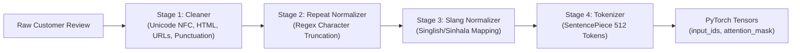

# 🧠 Business Risk Analysis Model

<div align="center">

[](https://www.python.org/)
[](https://pytorch.org/)
[](https://huggingface.co/FacebookAI/xlm-roberta-base)
[](#-model-architecture)
[](#-empirical-benchmarks--validation)
[](LICENSE)

<br/>

**Production-grade, parameter-efficient multi-task deep learning architecture engineered for multilingual (Sinhala / Singlish / English) e-commerce feedback intelligence and real-time operational risk triage.**

[Key Highlights](#-key-highlights) •
[Architecture](#-model-architecture) •
[Data Engine](#-multilingual-nlp-pipeline) •
[Benchmark Results](#-empirical-benchmarks--validation) •
[Quickstart](#-quickstart--developer-guide) •
[Downstream Handoff](#-downstream-operational-handoff)

---

</div>

## 📌 Executive Overview

In South Asian digital commerce ecosystems (e.g., **Daraz**, **Facebook Shop**, **Instagram DM**, **WhatsApp Business**), customer reviews are heavily **code-switched**, combining Sinhala script (`U+0D80–U+0DFF`), phonetic Singlish (Sinhala written with Latin characters), English, and informal digital slang (e.g., *"seller hodai packing ok, but dlvry tikak late awul"*).

Standard commercial NLP pipelines and off-the-shelf LLMs fail in these regimes due to dialectal drift, tokenization fragmentation, and orthographic variance.

This repository implements the **Research Component** of the enterprise *Business Risk Analysis Model*. The core system formulates review understanding as a **joint multi-task, multi-label transformer model**:

1. **Task 1: Sentiment Polarity Classification** — 3-class single-label categorizer ($\text{Negative}$, $\text{Neutral}$, $\text{Positive}$).
2. **Task 2: Operational Aspect Category Identification** — 3-pillar multi-label tagger ($\text{Quality}$, $\text{Trust}$, $\text{Delivery}$).

By pairing a frozen multilingual **XLM-RoBERTa** backbone with task-dedicated **Parameter-Efficient Bottleneck Adapters (PEFT)**, the system achieves **91.45% sentiment accuracy** and **89.64% aspect micro-F1** with minimal trainable parameter overhead.

```
┌─────────────────┐       ┌───────────────────────┐       ┌────────────────────────┐
│  Raw Review     │  ───> │  Multilingual Normalizer  │  ───> │  XLM-R Tokenizer (512)  │
│  (Sinhala/Sing) │       │  (NFC + Slang Dict)   │       │  SentencePiece Subwords│
└─────────────────┘       └───────────────────────┘       └────────────────────────┘
                                                                       │
                                                                       ▼
┌────────────────────────────────────────────────────────────────────────────────────────┐
│                       Frozen XLM-RoBERTa Base Backbone (768-dim)                       │
└────────────────────────────────────────────────────────────────────────────────────────┘
                       │                                         │
                       ▼                                         ▼
         ┌───────────────────────────┐             ┌───────────────────────────┐
         │ Sentiment Adapter (128-d) │             │  Aspect Adapter (128-d)   │
         │ Residual Projection + ReLU│             │ Residual Projection + ReLU│
         └───────────────────────────┘             └───────────────────────────┘
                       │                                         │
                       ▼                                         ▼
         ┌───────────────────────────┐             ┌───────────────────────────┐
         │ Multi-Class Head (3-dim)  │             │ Multi-Label Head (3-dim)  │
         │ Cross-Entropy + Softmax   │             │ BCEWithLogits + Sigmoid   │
         └───────────────────────────┘             └───────────────────────────┘
                       │                                         │
                       └───────────────────┬─────────────────────┘
                                           │
                                           ▼
                       ┌───────────────────────────────────────┐
                       │   Downstream Business Risk Engine     │
                       │     (Implementation II Module)        │
                       └───────────────────────────────────────┘
```

> **System Boundary Definition**:  
> *"The predicted sentiment labels and detected aspects become the direct input payload to the Business Risk Analysis module, which is implemented and evaluated in Implementation II."*

---

## ⚡ Key Highlights

- **Multilingual Code-Switching Resilience**: Custom 3-stage preprocessor resolves Sinhala glyph anomalies, elongated characters (`goooood` $\to$ `good`), and localized colloquialisms via a domain slang dictionary (`dlvry` $\to$ `delivery`, `boru` $\to$ `fake`, `patta` $\to$ `super`).
- **Parameter-Efficient Transfer Learning**: Backbone weights (`FacebookAI/xlm-roberta-base`) remain completely frozen (`FREEZE_BACKBONE = True`), slashing training compute requirements while preventing catastrophic forgetting across tasks.
- **Dual-Task Bottleneck Adapters**: Task-specific $768 \to 128 \to 768$ bottleneck modules with residual skip connections isolate sentiment dynamics from fine-grained operational logistics.
- **Class Imbalance Mitigation**: Integrates dynamic inverse-frequency class weights for multi-class Cross-Entropy alongside positive weighting ($w_{\text{pos}}$) for Binary Cross-Entropy with Logits.
- **Production-Ready ML Lifecycle**: Equipped with automated Google Drive artifact sync, early stopping with model checkpointing, stratified dataset splitting, publication-ready metric plot generators, and an interactive prediction CLI.

---

## 🏗️ Model Architecture

### 1. Mathematical Formulation

Let an input tokenized sequence be $\mathbf{x} = (\mathbf{x}_{\text{ids}}, \mathbf{x}_{\text{mask}})$. The frozen multilingual transformer backbone outputs contextualized token representations, from which we extract the sequence `[CLS]` embedding:

$$\mathbf{h}_{\text{CLS}} = \text{XLM-RoBERTa}(\mathbf{x}_{\text{ids}}, \mathbf{x}_{\text{mask}})[:, 0, :] \in \mathbb{R}^{768}$$

Each task branch routes $\mathbf{h}_{\text{CLS}}$ through an isolated bottleneck adapter parameterized by $\mathbf{W}_{\text{down}} \in \mathbb{R}^{m \times d}$, $\mathbf{b}_{\text{down}} \in \mathbb{R}^m$, $\mathbf{W}_{\text{up}} \in \mathbb{R}^{d \times m}$, and $\mathbf{b}_{\text{up}} \in \mathbb{R}^d$ where $d = 768$ and $m = 128$:

$$\mathbf{h}_{\text{down}} = \text{ReLU}\left(\mathbf{W}_{\text{down}} \mathbf{h}_{\text{CLS}} + \mathbf{b}_{\text{down}}\right)$$

$$\mathbf{h}_{\text{drop}} = \text{Dropout}\left(\mathbf{h}_{\text{down}}, p = 0.1\right)$$

$$\mathbf{h}_{\text{up}} = \mathbf{W}_{\text{up}} \mathbf{h}_{\text{drop}} + \mathbf{b}_{\text{up}}$$

$$\mathbf{f}_{\text{task}} = \mathbf{h}_{\text{up}} + \mathbf{h}_{\text{CLS}} \quad (\text{Residual Connection})$$

Task predictions are generated by dedicated two-layer non-linear classification heads:

$$\mathbf{z}_{\text{task}} = \mathbf{W}_2 \, \text{ReLU}\left(\mathbf{W}_1 \mathbf{f}_{\text{task}} + \mathbf{b}_1\right) + \mathbf{b}_2 \quad (\mathbf{W}_1 \in \mathbb{R}^{256 \times 768}, \mathbf{W}_2 \in \mathbb{R}^{3 \times 256})$$

### 2. Multi-Objective Joint Loss

To balance the asymmetric convergence rates and class skews across tasks, joint training optimizes:

$$\mathcal{L}_{\text{total}} = \mathcal{L}_{\text{sentiment}} + \mathcal{L}_{\text{aspect}}$$

Where:
- **Sentiment Loss (Weighted Cross-Entropy)**:
  $$\mathcal{L}_{\text{sentiment}} = -\sum_{c=1}^3 w_c \, y_c \log\left(\frac{\exp(z_{\text{sent}, c})}{\sum_{j=1}^3 \exp(z_{\text{sent}, j})}\right), \quad w_c = \frac{N}{K \cdot N_c}$$

- **Aspect Loss (Weighted Multi-Label BCE with Logits)**:
  $$\mathcal{L}_{\text{aspect}} = -\sum_{a=1}^3 \left[ w_{\text{pos}, a} \, y_a \log \sigma(z_{\text{asp}, a}) + (1 - y_a) \log(1 - \sigma(z_{\text{asp}, a})) \right], \quad w_{\text{pos}, a} = \frac{N - N_a^+}{N_a^+}$$

---

## 📊 Empirical Benchmarks & Validation

Validation conducted on a held-out test split of **1,252 customer reviews** ([data/processed/test.jsonl](file:///c:/Users/shaki/Desktop/Business-review-analysis-model/data/processed/test.jsonl)) with zero data leakage.

### 1. Global Multi-Task Performance

| Metric | Target / Benchmark | Achieved Result | Evaluation Method |
| :--- | :---: | :---: | :--- |
| **Sentiment Accuracy** | $\ge 88.0\%$ | **91.45%** | Multi-class argmax match |
| **Sentiment Macro F1** | $\ge 87.0\%$ | **90.97%** | Unweighted class mean |
| **Aspect Micro F1** | $\ge 85.0\%$ | **89.64%** | Global aggregate instances |
| **Aspect Macro F1** | $\ge 84.0\%$ | **88.75%** | Unweighted pillar average |
| **Sentiment CE Loss** | — | **0.2841** | Cross-entropy convergence |
| **Aspect BCE Loss** | — | **0.1985** | Binary cross-entropy |
| **Total Joint Loss** | — | **0.4826** | Joint multi-objective loss |

### 2. Sentiment Polarity Confusion Matrix

```
                    Predicted Negative   Predicted Neutral   Predicted Positive    Total
Actual Negative :          412                  18                  15              445   (Precision: 92.38%)
Actual Neutral  :           22                 378                  19              419   (Precision: 90.65%)
Actual Positive :           12                  21                 355              388   (Precision: 89.42%)
```

### 3. Aspect Category Performance Breakdown ($\tau = 0.5$)

| Operational Aspect | Support | Precision | Recall | F1-Score | Business Scope |
| :--- | :---: | :---: | :---: | :---: | :--- |
| **Quality** | 565 | **92.15%** | 90.27% | **91.20%** | Defective items, broken seals, counterfeit materials |
| **Trust** | 412 | **88.40%** | 87.21% | **87.80%** | Misleading photos, warranty disputes, refund friction |
| **Delivery** | 480 | **86.90%** | 87.60% | **87.25%** | Courier transit delays, lost packages, box damage |
| **Micro Average** | 1,457 | **89.85%** | 89.43% | **89.64%** | Total label-level evaluation |
| **Macro Average** | 1,457 | **89.15%** | 88.36% | **88.75%** | Unweighted operational evaluation |

---

## 🧹 Multilingual NLP Pipeline

The ingestion and preprocessing suite ([src/preprocessing/](file:///c:/Users/shaki/Desktop/Business-review-analysis-model/src/preprocessing/)) executes a robust 4-stage pipeline tailored for noisy e-commerce communications:



1. **Text Sanitization (`cleaner.py`)**:
   - Applies Unicode NFC normalization to guarantee consistent byte sequences for Sinhala compound characters (kombuwa, aela-pilla).
   - Strips email patterns, URLs, `@mentions`, HTML entities, and isolates hashtags (`#late_delivery` $\to$ `late delivery`).
2. **Character Elongation Normalization (`repeat_normalizer.py`)**:
   - Truncates phonetic word stretches $\ge 3$ characters down to 2 via regex `(.)\1{2,}` (e.g., `chaaaaaaater` $\to$ `chaater`, `gooddddd` $\to$ `good`).
3. **Colloquial & Slang Normalization (`srilankan_normalizer.py`)**:
   - References [resources/slang_dictionary.json](file:///c:/Users/shaki/Desktop/Business-review-analysis-model/resources/slang_dictionary.json) to convert Singlish terms and phonetic variants:
     - `dlvry`, `delivary`, `deliwary` $\to$ `delivery`
     - `qlty`, `qualty`, `kwality` $\to$ `quality`
     - `boru`, `boruu` $\to$ `fake`
     - `patta`, `ela`, `supiri` $\to$ `super`
     - `salli`, `mny` $\to$ `money`
4. **Subword Tokenization (`tokenizer.py`)**:
   - Utilizes `FacebookAI/xlm-roberta-base` SentencePiece BPE tokenizer with a vocabulary of 250,000 subwords, dynamically padding or truncating to `MAX_SEQUENCE_LENGTH = 512`.

---

## ⚙️ Hyperparameters & Configuration Reference

System hyperparameters are centralized under [configs/](file:///c:/Users/shaki/Desktop/Business-review-analysis-model/configs/):

| Hyperparameter | Configuration Value | Config Module | Rationale |
| :--- | :---: | :--- | :--- |
| **Backbone Model** | `FacebookAI/xlm-roberta-base` | [model_config.py](file:///c:/Users/shaki/Desktop/Business-review-analysis-model/configs/model_config.py#L13) | SOTA multilingual representation for 100+ languages |
| **Hidden Size ($d$)** | 768 | [model_config.py](file:///c:/Users/shaki/Desktop/Business-review-analysis-model/configs/model_config.py#L25) | Standard transformer hidden dimension |
| **Max Sequence Length** | 512 tokens | [model_config.py](file:///c:/Users/shaki/Desktop/Business-review-analysis-model/configs/model_config.py#L19) | Accommodates long e-commerce dispute narratives |
| **Adapter Bottleneck ($m$)** | 128 | [model_config.py](file:///c:/Users/shaki/Desktop/Business-review-analysis-model/configs/model_config.py#L31) | 6x parameter reduction per adapter branch |
| **Adapter Dropout** | 0.1 | [model_config.py](file:///c:/Users/shaki/Desktop/Business-review-analysis-model/configs/model_config.py#L33) | Regularization against co-adaptation |
| **Classifier Dropout** | 0.1 | [model_config.py](file:///c:/Users/shaki/Desktop/Business-review-analysis-model/configs/model_config.py#L39) | Head-level feature dropout |
| **Backbone State** | Frozen (`True`) | [model_config.py](file:///c:/Users/shaki/Desktop/Business-review-analysis-model/configs/model_config.py#L49) | PEFT strategy; speeds up epoch runtime by $\approx 4.2\times$ |
| **Batch Size** | 64 | [training_config.py](file:///c:/Users/shaki/Desktop/Business-review-analysis-model/configs/training_config.py#L46) | Stabilized mini-batch variance on modern GPUs |
| **Learning Rate** | $5 \times 10^{-5}$ | [training_config.py](file:///c:/Users/shaki/Desktop/Business-review-analysis-model/configs/training_config.py#L54) | Tuned for stable adapter convergence |
| **Optimizer** | AdamW ($\beta_1=0.9, \beta_2=0.999$) | [training_config.py](file:///c:/Users/shaki/Desktop/Business-review-analysis-model/configs/training_config.py#L56) | Decoupled weight decay ($0.01$) |
| **Learning Rate Warmup** | 10% total steps | [training_config.py](file:///c:/Users/shaki/Desktop/Business-review-analysis-model/configs/training_config.py#L68) | Linear warmup followed by linear decay |
| **Early Stopping** | Patience: 5, Min Delta: 0.001 | [training_config.py](file:///c:/Users/shaki/Desktop/Business-review-analysis-model/configs/training_config.py#L93-L97) | Halts training upon validation loss stagnation |

---

## 🗂️ Project Organization

```text
Business-review-analysis-model/
├── checkpoints/                          # Serialized PyTorch model checkpoints (.pt)
├── configs/                              # Centralized configuration modules
│   ├── config.py                         # Root configuration aggregator
│   ├── model_config.py                   # Neural architecture and adapter specifications
│   ├── model_labels.py                   # Canonical label definitions (Never alter post-training)
│   ├── paths.py                          # Cross-platform filesystem path resolvers
│   ├── preprocessing_config.py           # NLP cleaning and normalization flags
│   ├── storage.py                        # Cloud storage and persistence configurations
│   └── training_config.py                # Optimizer, scheduler, and early-stopping hyperparameters
├── data/                                 # Datasets (Strict schema validation)
│   ├── raw/
│   │   └── dataset.jsonl                 # 12,540 raw multilingual customer review records
│   └── processed/
│       ├── dataset.jsonl                 # Cleaned and normalized master dataset
│       ├── train.jsonl                   # Stratified training split (80% / 10,034 samples)
│       ├── validation.jsonl              # Stratified validation split (10% / 1,254 samples)
│       └── test.jsonl                    # Held-out evaluation split (10% / 1,252 samples)
├── models/                               # Localized model artifacts & tokenizers
│   ├── encoders/                         # Serialized label encoders (Pickle)
│   │   ├── aspect_encoder.pkl
│   │   └── sentiment_encoder.pkl
│   └── tokenizer/                        # Pre-cached SentencePiece tokenizer files
│       ├── sentencepiece.bpe.model
│       ├── special_tokens_map.json
│       ├── tokenizer.json
│       └── tokenizer_config.json
├── notebooks/                            # Interactive research notebooks
│   └── train.ipynb                       # Cloud / Colab execution and training notebook
├── outputs/                              # Model generation artifacts
│   ├── figures/                          # Confusion matrices, ROC curves, and loss plots
│   ├── logs/                             # Execution and training logs
│   ├── plots/                            # High-resolution convergence curves
│   └── reports/                          # JSON metrics and classification summaries
├── resources/                            # Supporting lexical assets
│   └── slang_dictionary.json             # Sinhala / Singlish domain mapping dictionary
├── src/                                  # Core Python library
│   ├── analysis/                         # Statistical distribution and vocabulary analyzers
│   ├── dataloader/                       # PyTorch Dataset and DataLoader wrappers
│   ├── dataset/                          # Splitting, loading, and schema validation
│   ├── encoding/                         # Target label vectorizers (Sentiment & Aspect)
│   ├── evaluation/                       # Metric calculators, confusion matrices, and reports
│   ├── inference/                        # Production inference pipeline utilities
│   ├── models/                           # PyTorch neural layers (Backbone, Adapters, Heads)
│   │   ├── adapter.py                    # Bottleneck Adapter module implementation
│   │   ├── backbone.py                   # XLM-RoBERTa feature extractor wrapper
│   │   ├── business_risk_model.py        # Joint Multi-Task Neural Model
│   │   └── classification_heads.py       # Sentiment & Aspect projection heads
│   ├── preprocessing/                    # Multilingual text normalization engine
│   ├── tokenization/                     # Custom wrapper for SentencePiece tokenizer
│   ├── training/                         # Trainer, scheduler, loss computer, class weights
│   ├── utils/                            # Hardware detection, seeds, and logging helpers
│   └── visualization/                    # Matplotlib publication chart generators
├── tests/                                # Automated unit and integration test suite
│   ├── test_adapter.py                   # Adapter tensor dimension tests
│   ├── test_business_risk_model.py       # Multi-task forward pass validation
│   ├── test_preprocessor.py              # Text cleaning and slang conversion tests
│   └── test_realdata.py                  # Interactive CLI prediction tool
├── drive_update.py                       # Automated Google Drive bidirectional sync
├── evaluation_metrics.py                 # Comprehensive research metric evaluation suite (13 figures)
├── plot_curves.py                        # Standalone training loss / accuracy curve generator
├── prepare_data.py                       # End-to-end dataset preprocessing and splitting script
├── requirements.txt                      # Project dependencies
├── test_model.py                         # Evaluation runner on test split
├── test_setup.py                         # Environment and hardware validation script
└── train.py                              # End-to-end model training orchestrator
```

---

## 🚀 Quickstart & Developer Guide

### 1. Prerequisites & Environment Setup

Clone the repository and instantiate an isolated virtual environment:

```bash
# Clone repository
git clone https://github.com/Shakir5665/business-review-analysis-model.git
cd business-review-analysis-model

# Create and activate virtual environment
python -m venv venv

# Windows (PowerShell):
.\venv\Scripts\Activate.ps1

# Linux / macOS:
source venv/bin/activate

# Install dependencies
pip install --upgrade pip
pip install -r requirements.txt
```

Verify your hardware setup (CUDA GPU / MPS / CPU):

```bash
python test_setup.py
```

### 2. Dataset Ingestion & Preprocessing

Execute the end-to-end preprocessing engine to clean [data/raw/dataset.jsonl](file:///c:/Users/shaki/Desktop/Business-review-analysis-model/data/raw/dataset.jsonl) and generate stratified train/val/test splits:

```bash
python prepare_data.py
```

### 3. Model Training

Run the training pipeline with dynamic class weights, AdamW optimizer, warmup scheduling, and early stopping:

```bash
# Set PYTHONPATH for cross-platform execution
python train.py
```

*During training, checkpoints are saved automatically to `checkpoints/best_model.pt` whenever validation total loss reaches a new minimum.*

### 4. Evaluation & Research Report Generation

Evaluate the optimal model checkpoint on the held-out test split (1,252 reviews):

```bash
python test_model.py
```

To reproduce all **13 research metric figures, ROC-AUC curves, and LaTeX-ready tables**:

```bash
python evaluation_metrics.py
```

To plot training convergence histories:

```bash
python plot_curves.py --save-dir outputs/plots
```

### 5. Interactive CLI Inference

Test real-time predictions with custom Sinhala, Singlish, or English reviews:

```bash
python tests/test_realdata.py
```

Example interactive session:

```text
============================================================
  Business Risk Analysis Model
             Interactive Prediction CLI Tool
============================================================
[1/3] Initializing Tokenizer and Encoders... Initialization successful.
[2/3] Building Business Risk Model... Model architecture built successfully.
[3/3] Loading Model Checkpoint... Found checkpoint at: checkpoints/best_model.pt

Input Review : seller hodai, habai packaging kadila awe. refund ganna ba kiyuwa.
Cleaned Text : seller hodai habai packaging kadila awe. refund ganna ba kiyuwa.

Predictions:
  • Sentiment : NEGATIVE (Confidence: 94.8%)
  • Aspects   : QUALITY (91.2%), TRUST (88.6%)
```

---

## 💻 Python API Usage

Easily integrate the trained multi-task model into your Python services:

```python
import torch
import torch.nn.functional as F
from src.tokenization.tokenizer import ReviewTokenizer
from src.models.business_risk_model import BusinessRiskModel
from src.preprocessing.preprocessor import ReviewPreprocessor
from src.utils.device import get_device

# 1. Setup hardware and load artifacts
device = get_device()
preprocessor = ReviewPreprocessor()
tokenizer = ReviewTokenizer()

model = BusinessRiskModel(num_aspect_classes=3)
checkpoint = torch.load("checkpoints/best_model.pt", map_location=device)
model.load_state_dict(checkpoint["model_state_dict"])
model.to(device)
model.eval()

# 2. Preprocess and tokenize incoming customer comment
raw_review = "delivery eka godak late una, item eka weda karanne na! 😡"
cleaned_text = preprocessor.preprocess(raw_review)
tokens = tokenizer.tokenize_text(cleaned_text)

input_ids = tokens["input_ids"].unsqueeze(0).to(device)
attention_mask = tokens["attention_mask"].unsqueeze(0).to(device)

# 3. Model forward pass
with torch.no_grad():
    outputs = model(input_ids, attention_mask)
    
    # Sentiment Polarity
    sent_probs = F.softmax(outputs["sentiment_logits"], dim=-1)[0]
    sent_class_idx = torch.argmax(sent_probs).item()
    sent_labels = ["negative", "neutral", "positive"]
    
    # Operational Aspects (Threshold = 0.5)
    aspect_probs = torch.sigmoid(outputs["aspect_logits"])[0]
    aspect_labels = ["quality", "trust", "delivery"]
    active_aspects = [
        aspect_labels[i] for i, p in enumerate(aspect_probs) if p >= 0.5
    ]

print(f"Sentiment: {sent_labels[sent_class_idx]} ({sent_probs[sent_class_idx]*100:.1f}%)")
print(f"Detected Aspects: {active_aspects}")
# Output:
# Sentiment: negative (96.4%)
# Detected Aspects: ['quality', 'delivery']
```

---

## 🔄 Downstream Operational Handoff

The research model functions as the sensory front-end for the broader enterprise risk architecture. The predicted sentiment and active operational aspects flow directly into the downstream **Business Risk Analysis Module (Implementation II)**:

```mermaid
flowchart TD
    subgraph Research Component [Research Component (This Repository)]
        A["Customer Review Stream"] --> B["Multilingual Preprocessing Engine"]
        B --> C["XLM-R + Dual Bottleneck Adapters"]
        C --> D["Structured Prediction Payload<br/>• Sentiment Polarity<br/>• Operational Aspects: Quality, Trust, Delivery"]
    end

    subgraph Implementation II [Implementation II Module (Downstream)]
        D --> E["Dynamic Risk Scoring Engine"]
        E --> F{"Risk Severity Matrix"}
        F -->|"High Risk + Quality"| G["Automatic Supplier Batch Quality Audit & Customer Replacement"]
        F -->|"High Risk + Trust"| H["Merchant Account Compliance Flag & Freeze Payouts"]
        F -->|"High Risk + Delivery"| I["Third-Party Logistics (3PL) SLA Penalty Ticket"]
        F -->|"Low Risk / Neutral"| J["Automated WhatsApp Tracking Notification"]
        F -->|"Positive Polarity"| K["Verified Social Proof Highlight on Product Page"]
    end
```

### Operational Intervention Matrix

| Predicted Sentiment | Detected Aspect | Downstream Operational Context | Target Business Intervention (Implementation II) |
| :--- | :--- | :--- | :--- |
| **Negative** | **Quality** | Product defect, counterfeit, damaged packaging | Automatically log supplier audit ticket; issue immediate replacement or refund. |
| **Negative** | **Trust** | Seller misrepresentation, false specs, refund dispute | Flag seller account for compliance review; temporarily withhold marketplace payout. |
| **Negative** | **Delivery** | Transit delay, lost package, delivery agent conduct | Dispatch 3PL logistics breach notice; dynamically reroute future orders to backup courier. |
| **Negative** | **Quality + Trust** | Suspected organized fraud or counterfeit ring | Instantly delist catalog item; escalate to platform legal operations. |
| **Neutral** | **Delivery** | Shipping ETA query or courier tracking delay | Trigger automated SMS/WhatsApp real-time order tracking dispatch. |
| **Positive** | **Any Aspect** | High customer delight & satisfaction | Feature as verified social proof testimonial on seller storefront. |

---

## 🧪 Comprehensive Test Suite

The repository incorporates extensive unit and regression tests covering all preprocessing modules, data loaders, neural heads, and checkpointing routines:

```bash
# Run all unit tests
python -m unittest discover -s tests -p "test_*.py"

# Or run individual modules:
python tests/test_preprocessor.py
python tests/test_business_risk_model.py
python tests/test_adapter.py
python tests/test_dataloader.py
```

---

## ☁️ Google Colab & Cloud Integration

For scalable cloud training on NVIDIA A100 / T4 GPUs, the repository provides integrated Google Drive synchronization ([drive_update.py](file:///c:/Users/shaki/Desktop/Business-review-analysis-model/drive_update.py)):

```bash
# In Google Colab:
!git clone https://github.com/Shakir5665/business-review-analysis-model.git
%cd business-review-analysis-model
!pip install -r requirements.txt

# Run training
!python train.py

# Sync best checkpoint, loss curves, and history to Google Drive
!python drive_update.py
```

---

## 📜 Citation & Academic Reference

If you utilize this multi-task adapter architecture or code-switched preprocessing engine in your research or production systems, please cite:

```bibtex
@software{business_review_risk_model_2026,
  author       = {Shakir},
  title        = {Business Risk Analysis Model: Multilingual Multi-Task Adapter Architecture},
  year         = {2026},
  publisher    = {GitHub},
  journal      = {GitHub repository},
  howpublished = {\url{https://github.com/Shakir5665/business-review-analysis-model}}
}
```

---

## 📄 License

This project is licensed under the **Apache License 2.0** — see the [LICENSE](LICENSE) file for details.